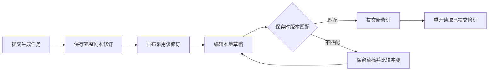

# 客户端重构应先保证可靠保存

这份研究供重构实施者确定客户端和评测的技术边界：让生成结果进入画布，编辑后可靠保存，冲突可处理，重开可恢复，再验证性能和事实质量。源码基点为 `feca892bfbaf7b7a9ca04dc87b2908ad03d7fc9f`；官方资料查阅日期为 2026-11-19。本轮只读代码与资料，没有运行 benchmark、真实模型或端到端测试。

锁文件记录 React 19.2.8、React Flow 12.11.2、Zustand 5.0.14、dagre 3.1.1。下文是实施建议及拟议验收方法；已有功能研究和待确认产品建议的地位保持不变。

## 实施顺序以可靠性为先

- 生成完成与保存成功都应对应已提交的剧本修订。
- 详情面板按内容订阅，减少拖动造成的无关渲染。
- 布局移入 Worker、视口裁剪均由基准决定适用范围。
- 任务进度保存到服务端，断线后按游标补发。
- 必要评测缺失时保持阻塞，关键矛盾直接判失败。

| 术语 | 本文含义 |
| --- | --- |
| 修订 | 一次保存形成的不可变剧本版本 |
| ETag | HTTP 表示的版本标识，供条件写入校验 |
| SSE | 服务端事件流，传递任务进度和完成通知 |
| P95 | 95% 样本不超过的测量值 |

## 源码显示流程存在断点

以下观察固定于上述提交，作为并行重构的对照；后续实现按对应行为复验。

| 观察 | 代码位置 |
| --- | --- |
| 完成帧只更新剧本 ID；工作台没有替换画布 | `ProgressBand.tsx:71`、`WorkbenchView.tsx:46` |
| 保存只改本地节点；表单只在节点 ID 变化时初始化 | `NodeDrawer.tsx:42,57` |
| 编辑复制整图作为撤销快照；每项位置变化遍历节点 | `useGraphStore.ts:16,85,94` |
| 流解析忽略事件 ID；请求及载入失败回退示例 | `live.ts:70,107,133,271` |
| 服务端先发送完成帧，再写内存缓存；断线设置停止标记 | `serve.py:257,276,282` |
| 支持判据依赖词元重叠，最多检查前 40 条声明；跳过必要层仍可能总判通过 | `eval_/runner.py:37,197,250,467` |

前端位置相对 `frontend/src/`，后端位置相对 `src/tindalos/`。用户指定的评测文件实际位于 `src/tindalos/eval_/runner.py`；功能约束另见 [deep-functional-design.md](deep-functional-design.md)。

## 生成和编辑共享修订协议

建议流程如下，图为拟议协议。

生成结束应先校验完整剧本，再以一次 store 动作写入剧本、修订号及派生节点和边。正文、关系来自剧本，坐标、选择和视口属于展示状态。文本编辑无需重新布局；关系变化才重建受影响部分。局部重生成可能改变多个对象，响应必须按修订整体核对，避免只更新一个节点却替换全图边。

生成请求从提交动作启动，进度组件负责订阅。React 官方建议把交互触发的写请求放入事件处理器 [S2]。每次明确生成使用独立任务身份，相同文本也可再次提交；切换任务后，旧响应按任务和修订身份过滤。

保存应先把展示字段映射回领域字段，例如幕提要与节点描述不能混写。请求携带基准修订，服务端在同一 SQLite 事务中校验版本、写新修订并更新当前指针，提交成功后返回完整修订。采用强 ETag 与 `If-Match`，不匹配返回 412 [S5]。覆盖已有剧本的生成和局部重生成也遵守此条件；网络超时后用幂等请求身份查询结果，避免重复提交。

详情草稿记录基准修订和已改字段。收到同节点新内容时，干净草稿同步，未保存草稿提示比较；不能把依赖改为整个节点对象后自动覆盖输入。保存失败保留草稿，确认响应后才显示已保存。重开读取服务端修订，示例数据只在明确的演示入口加载。

## 大图优化从订阅和布局入手

频繁节点变化会引发无关渲染，React Flow 官方将其列为性能问题 [S1]。详情面板宜订阅选中节点的内容引用，状态标签单独订阅；位置更新保持内容引用稳定。先用选择器查找，基准显示扫描成本突出时再建 ID 索引。返回数组或对象的选择器使用稳定引用或 `useShallow`；Zustand 5 明确要求稳定输出 [S3]。

React 外部 store 快照需要不可变且可缓存；外部 store 更新也不能靠 `startTransition` 保证非阻塞 [S2]。因此应减少更新量：批量位置变化一次应用，无变化保留引用，撤销保存字段前后值及基准修订。内容与关系一次提交，撤销不得回滚后来的拖动。

映射线索引用时可预建节点 ID 集合，替代逐条全表查找。dagre 只在初载、结构改变或用户请求重排时运行；若布局造成长任务，再移入 Web Worker，并丢弃过期修订的布局结果。保留节点组件、回调及配置的稳定引用。大图可按幕折叠，明确处理跨幕边。

视口裁剪会增加可见性计算，官方并未承诺总能提速 [S1]。只有少量节点可见且测得收益时才开启，同时检查边、选择与重新出现节点的尺寸。官方当前主线已是 React Flow 13，订阅 API 和变更回调有破坏性变化 [S1]；本轮方案以 v12 为基线，升级收益须单独比较。

## 进度恢复依赖持久化任务

SSE 规范定义自动重连、事件 ID、重试时间及 `Last-Event-ID` [S4]；基点中的 POST fetch 流没有这些自动恢复能力。建议先 POST 创建任务并返回任务 ID，再 GET 订阅事件；需要自定义认证头时保留 fetch，显式实现重连、退避和游标，解析器保留事件 ID 与重试时间。

同一 SQLite 数据库保存任务状态、递增序号、服务端时间及结果修订。事件提交后再发送，客户端按任务和序号去重；刷新后先取状态快照，再补事件。游标过期返回新快照，终态事件可重复读取。界面批量更新有限事件窗口，完整记录保留在服务端。阶段没有可靠总量时显示阶段与耗时，避免伪造百分比。

断开观察连接与取消执行分开；取消走明确命令。服务重启后依据心跳和执行租约标记中断，只有阶段支持幂等或检查点时才恢复执行。SQLite 允许多个读事务，但同时只有一个写事务 [S6]：模型调用放在事务外，事件短事务提交，写竞争记录等待和重试。完成状态与结果修订在同一事务提交后才发布。

## 事实评测必须保留未知

检索相关性只能筛选候选证据。FActScore 把文本拆成原子事实，核对可靠来源的支持比例；FEVER 区分支持、反驳和信息不足，并为前两类标注证据 [S7、S8]。这些方法可借用，人物传记或维基百科上的效果不能直接作为中文模组的准确率。语料是否存在应单独检查，零命中保留检索未覆盖状态。

建议保留现有确定性结构层，事实层逐项记录主体、谓词、时间、知情范围及来源修订，再分类为支持、矛盾、未知。证据保存原文范围与哈希；人物声称的内容不能自动当作世界真相。模型判定限定给定证据，解释须引用片段，判定输出格式无效、预算不足或超时保持未完成。创作补充单独标记来源和采纳状态。

评测配置预先声明必要层及覆盖范围。关键事实矛盾判失败，缺语料、评判器不可用、必需人工层未完成则阻塞；必要结论缺乏支持也阻塞，允许保持未定的内容按未知标签核对。执行结束和质量通过分别记录。保留 40 条预算时按对象和重要性分层抽样，报告总声明数、已评数和未评数。支持精度之外，还需统计关键事实召回，避免短文本因遗漏内容得高分。

## 验收记录故障和完整分母

以下负载与门槛均为建议，尚无本项目测量结果。用 Performance API 和浏览器轨迹记录耗时、长任务及内存，详情渲染另用 React Profiler 的分析构建记录。

| 验证项 | 方法与验收依据 |
| --- | --- |
| 性能基准 | 固定设备、浏览器、锁文件和生产构建；100、1000、5000 节点分别配每节点约 2、6 条边，固定文本长度及可见比例；各重复 20 次，记录映射、布局、首屏 P50/P95、拖动帧间隔、长任务、堆占用和详情提交次数 |
| 优化对照 | 同一数据逐项比较选择器、撤销补丁、Worker、裁剪；建议编辑响应 P95 ≤100ms、拖动帧间隔 P95 ≤33ms，布局出现 >50ms 主线程任务时评估 Worker；同时报告最大可用规模 |
| 保存恢复 | 生成 A、编辑保存、重开核对正文和关系；双标签页并发保存应有一次 412 且草稿可恢复；注入事务失败、响应丢失及旧重生成响应，不得显示虚假成功或覆盖新修订 |
| 任务恢复 | 注入断线、刷新、重复事件、游标过期及进程重启；序号补齐且不重复，完成任务可重新取得结果，中断和取消状态可区分 |
| 并发进度 | 以 1、4、16 个任务注入固定事件速率，记录队列长度、进度延迟 P95、SQLite 写等待和提交耗时；报告饱和点，不能丢失终态或出现重复修订 |
| 事实评测 | 独立 KP 双人标注并裁决分歧，冻结证据和测试集；覆盖否定、同名、时间变化、传闻及未知。分别提供标准证据和实际检索，报告混淆矩阵、证据定位准确率、覆盖率、关键事实召回及成本；阻塞案例不得总判通过，关键矛盾样例错误通过数应为 0 |

模型评判器需要对照人工标签校准，并保留每次运行结果 [S9]。拟议关键案例全部通过只说明该测试集的结果，实际主持可用性仍需独立 KP 走查。

## 第一手来源

| 编号 | 来源与适用范围 |
| --- | --- |
| S1 | React Flow 官方[性能指南](https://reactflow.dev/learn/advanced-use/performance)、[视口裁剪参数](https://reactflow.dev/api-reference/react-flow)、[v13 迁移指南](https://reactflow.dev/learn/troubleshooting/migrate-to-v13)、[版本记录](https://reactflow.dev/whats-new)：优化原则及版本边界 |
| S2 | React 官方[外部 store 订阅](https://react.dev/reference/react/useSyncExternalStore)、[Effect 依赖与交互请求](https://react.dev/learn/removing-effect-dependencies)：快照一致性与请求触发 |
| S3 | Zustand 官方[稳定选择器输出](https://zustand.docs.pmnd.rs/reference/migrations/migrating-to-v5)、[useShallow](https://zustand.docs.pmnd.rs/reference/hooks/use-shallow)：适用于应用自己的 Zustand 5 store |
| S4 | [WHATWG SSE 规范](https://html.spec.whatwg.org/multipage/server-sent-events.html)：事件格式及浏览器重连协议；不提供服务端持久化 |
| S5 | [RFC 9110 §13.1.1](https://www.rfc-editor.org/rfc/rfc9110.html#section-13.1.1)：条件写入与强版本比较 |
| S6 | SQLite 官方[事务](https://www.sqlite.org/lang_transaction.html)、[WAL](https://www.sqlite.org/wal.html)：事务及写并发约束 |
| S7 | Sewon Min 等，[FActScore，EMNLP 2023](https://aclanthology.org/2023.emnlp-main.741/)：原子事实与支持精度 |
| S8 | James Thorne 等，[FEVER，NAACL 2018](https://aclanthology.org/N18-1074/)：三类事实标签及证据标注 |
| S9 | OpenAI 官方[评测实践](https://developers.openai.com/api/docs/guides/evaluation-best-practices)：独立测试集与人工校准；该页注明 Evals 平台计划退役，本文采用方法，自建评测执行器 |

## 写作核对记录

已按 doc-writing 确定读者、目标及结构，按 de-ai-tech-writing 区分源码观察、来源结论和实施建议，再按 haohao-shuohua 分别回读事实、表达和节奏。数字、版本、命令、技术机制及来源方向保留；没有补写性能收益。清洗减少重复说明，将标识符集中到定位表，主线保持为可靠保存、任务恢复及可核验评测。

2026-11-19 实际执行 `python3 -B /Users/bytedance/.agents/skills/haohao-shuohua/scripts/quick_scan.py docs/research-client-evaluation.md`。初稿及交付版的半角标点、破折号串、B2 变体、元话语、序号标题和免责尾巴各为 0 处，退出码 0；没有需处理项或豁免。节奏粗筛命中一处长气口，已补自然停顿。文字检查不构成功能验收。
