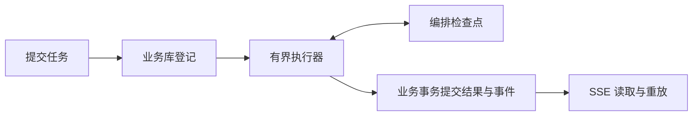

# 单机运行与可靠存储建议

本文供重构执行者选择运行与存储方案，让生成、保存、编辑与续团遵守可靠写入规则。建议保留模块化单体与 SQLite，先修复事务、阻塞和任务恢复，再由负载证据决定迁移。

研究日期为 2026-11-19，源码基线为 `feca892bfbaf7b7a9ca04dc87b2908ad03d7fc9f`。已读项目约定、[决策日志](refactor-decision-log.md)、[澄清记录](refactor-clarification.md)、[功能设计](deep-functional-design.md)与依赖声明。现状表对应本轮开始时的源码，并行重构的未提交变更需另行复核。本轮完成静态审查、官方资料核对和解释器版本读取；系统压测、模型调用与故障注入均未执行。

| 术语 | 本文含义 |
|---|---|
| WAL | 预写日志，允许读写并行，仍只有一个写者 |
| CAS | 比较后更新，用版本或状态条件防止覆盖 |
| FTS5 | SQLite 全文索引，提供关键词检索 |
| SSE | 服务端事件流，连接与后台任务分别管理 |
| 检查点 | 编排恢复状态，业务事实另由业务库保存 |

## 当前源码存在写入与恢复缺口

| 已核对行为 | 源码位置 |
|---|---|
| 生成失败之外，保存异常被忽略，仍发送完成；重生成、评测和 PDF 解析直接在异步端点调用同步函数 | [web.py](../src/tindalos/web.py)，生成、重生成、上传、评测端点 |
| 同 ID 剧本覆盖；场次按最大编号加一；评测终态先读再无条件更新 | [history.py](../src/tindalos/history.py) 的 register_campaign；[memory_entries.py](../src/tindalos/memory_entries.py) 的 record_session；[eval_store.py](../src/tindalos/eval_store.py) 的 finalize_run |
| 记忆与评测连接每次建表，多步写入使用逐语句自动提交；记忆检索每次加载全部有效条目并重建 BM25 | 两个存储模块；记忆模块的 assemble_memory_context |
| 每次网页生成新建线程与随机编排 ID；事件没有序号；断线与停止生成绑定；结束帧入队没有超时 | [serve.py](../src/tindalos/serve.py) 的 default_generate、sse_frame；网页生成端点 |

竞争发生率与吞吐上限尚无实测。业务库未显式配置 WAL；[官方 SqliteSaver][saver]启用 WAL，用锁串行访问，其他库仍需配置。

## 研究决定先落实单机可靠性

RT00 是技术研究子任务的执行范围：只写本文件，不改产品代码、不增加基础设施。RT01 至 RT05 是该子任务提交的研究建议；本文件保留当时状态，主任务是否采纳及具体实现以[决策日志](refactor-decision-log.md)为准。

建议的单机流程如下，图示不代表现有实现。



### RT01 将必要写入放进业务事务

剧本修订、确认事件、场次、任务与事件日志应归入同一业务库。保存提交后才能确认，摘要和索引可重建。[WAL][wal]只保证各库分别原子提交。检查点继续独立，业务提交按操作 ID 去重；恢复时核对提交登记，补齐尚未登记的结果。

迁移先备份，核对条数、引用与哈希，保留旧库。[在线备份 API][backup]可取得一致快照；多库应暂停业务写入再一起备份，运行中只复制主库文件可能漏掉 WAL。

### RT02 用短事务与索引控制竞争

[SQLite 事务][transaction]支持提前取得写锁。编号分配与插入、版本替换、确认事件与状态更新应同事务提交，异常回滚。模型、解析和网络重试放在事务外。剧本采用不可变修订加版本 CAS，冲突返回 409；评测终态用运行中状态作条件，检查受影响行数。场次与任务增加唯一约束及请求幂等键，同键异内容拒绝。

以下为拟议条件更新，剧本头表需在迁移时建立；两种更新都要求受影响行数为 1。

```sql
UPDATE campaign_heads SET revision_id=?, version=version+1
WHERE campaign_id=? AND version=?;
UPDATE eval_runs SET status=?, updated_at=?
WHERE run_id=? AND status='running';
```

| 建议起始设置 | 理由与风险 |
|---|---|
| 本机文件；WAL；每连接启用外键和 1000ms 锁等待 | WAL 不适用于网络文件系统；等待超限应显式失败，不能无限重试 |
| 必要业务写入与检查点使用同步级别 FULL | [官方配置][pragma]说明 WAL 下 NORMAL 可能在断电后丢失已提交事务；FULL 仍依赖存储正确同步 |
| 多步写入显式 BEGIN IMMEDIATE；迁移集中到启动阶段 | 避免读后升级竞争及请求路径重复 DDL |
| 按战役、有效状态、类型、时间和 ID 建组合索引；任务事件索引按任务与序号 | 使用[查询计划][eqp]核对实际过滤与排序，列表采用游标分页 |

[官方 WAL 文档][wal]报告并发写入／检查点竞态已在 3.51.3 修复，回补版为 3.44.6、3.50.7。上线须核对链接的 SQLite，采用含修复的版本；Python 依赖下限无法保证底层版本。长读事务阻碍检查点，应分批读完即关闭，监测日志大小与锁等待，空闲时执行被动检查点。

全文检索先用当前单字／二元分词处理文档和查询，正文与[FTS5][fts]同事务维护，迁移后重建核对。默认 Unicode61 不提供中文语义分词；三元分词无法匹配少于三个字符的全文查询。FTS5 的 BM25 越小越相关，应在固定查询集比较召回与排序后替换；仍须过滤战役、状态及知情范围。

### RT03 隔离阻塞并管理资源寿命

[FastAPI][async]自动把同步端点和依赖放进线程池，异步端点直接调用同步函数仍会阻塞。数据库、解析和 requests 调用应显式隔离；计算密集解析可用有界进程池。[Starlette][pool]默认共享 40 个线程令牌，长期生成不应占满此池。

由[生命周期][lifespan]创建、关闭执行器与连接；必需库初始化失败不得就绪，退出先停止接单再有限等待。业务连接在执行线程内创建、关闭；编排协调与叶子调用避免在同一满载池互相等待，防止[死锁][futures]。

### RT04 持久化任务身份并限制模型并行

每个任务保存输入修订、提示词／模型／图版本和编排 ID；新任务新 ID，重试沿用原 ID。[持久化规则][checkpoints]区分新输入、故障恢复与人工中断恢复：故障继续传空输入，中断使用恢复命令，不能重新提交原输入冒充恢复。

关键步骤采用 `durability="sync"`；[节点重执行][fault]仍可能重复副作用。模型调用分别封装为可恢复任务，写入用稳定操作 ID 去重；提供方不支持幂等时，远端成功但本地未记录仍可能重复计费。图升级须保持任务顺序兼容，或在旧图完成旧任务。

建议起始上限为运行 2 个任务、排队 100 个、图并发 4、全局模型调用 4，均待测。[图并发参数][concurrency]放在顶层，各任务还须共用模型限额。接单与认领用事务控制容量和租约；心跳续租，过期后接管并递增执行代次，提交必须核对代次。取消与重试共用绝对截止时间及预算。

### RT05 让重连只订阅原任务

任务 POST 返回 202 与 ID，再用 GET 订阅。事件在事务内分配序号并落库；按[SSE 标准][sse]支持 Last-Event-ID、重试间隔和约 15 秒注释心跳。重连重放原任务，客户端按序号去重；游标过期先返回状态快照与重置游标。慢客户端分批读取并释放事务，通知队列不能阻塞结束。

断线停止订阅。显式取消持久化意图，在安全边界停止新步骤；完成与取消由事务 CAS 决定唯一终态。[运行中的线程无法强制取消][futures]，须等待调用超时并拒绝取消后提交。终态事件与结果引用一起提交，客户端随后关闭连接。

## 迁移由负载和部署要求触发

| 方案 | 现实适用条件与代价 |
|---|---|
| 模块化单体＋SQLite | 本机可靠磁盘、单服务进程、有界任务；满足下述目标时维护成本低。写锁和单机故障是限制，多进程前先解决共享限额与任务租约 |
| PostgreSQL＋Redis 队列 | 多主机执行、持续写竞争或高可用成为实际需求时再评估。[PostgreSQL MVCC][pg]支持并发事务，仍需 CAS。Redis 增加运维、投递确认与重投；[Streams][streams]提供待确认与接管机制，[每秒 AOF][aof]仍有丢失窗口。业务事务发件箱与消费者去重不可省略 |

两项迁移分别评估：可以先迁移数据库，继续使用数据库任务表。当前没有增加 PostgreSQL、Redis 或云服务的决定。

## 验收必须保留可重放证据

以下是建议验收协议及起始目标，尚未执行。候选实现与基线在同机独立副本运行，固定 Python 3.12＋、依赖、SQLite 版本、PRAGMA、硬件、随机种子 42 与输入哈希。种入 100 个战役、10 万记忆条目、1000 份 100KB 剧本；模型替身每次延迟 2 秒并记录调用次数。预热 60 秒，持续 10 分钟，重复 3 次；真实模型费用与延迟另测。

| 操作与故障注入 | 判定与保留证据 |
|---|---|
| 20 个客户端，每个每秒读取一次，每五次读取提交一次编辑；同时提交 20 个生成任务；查询集含双字姓名 | 读接口 p95≤200ms；保存 p95≤500ms；事件循环延迟 p99≤50ms；任务、模型和队列不超限。分别记录锁等待、排队、执行与模型耗时，错误按类型计数 |
| 同幂等键并发提交 100 次；同版本并发编辑 20 次；场次并发写入 100 次 | 前者仅一项任务／场次；同版本仅一项成功，其余 409；编号不重复，终态不能改写 |
| 在业务提交前后、检查点前后 SIGKILL；注入满盘、只读和网络超时；每点重放 20 次 | 已确认业务记录零丢失、零重复；失败不能显示保存成功；租约到期恢复任务，迟到执行者不能提交。保存输入、事务日志、退出点和恢复后哈希 |
| 第 5 个事件后断线重连 10 次；客户端暂停读取 60 秒；完成与取消同时触发 | 不新建任务；按序号补齐且终态唯一；客户端去重后无重复；取消后无新调用或结果提交 |
| 从同一备份恢复；长读事务并发写入后释放读者；重建全文索引 | 完整性与外键检查通过，业务哈希一致；检查点追平后日志可回收；检索结果保持战役与知情隔离。SIGKILL 不能替代断电验收 |

## 写作与证据核对记录

已按 doc-writing 定结构、de-ai-tech-writing 写技术正文，再按 haohao-shuohua 分别核对事实、表达与节奏；研究建议和实测状态分开。检查解释器为 Python 3.9.6、SQLite 3.51.0，仅用于读取与扫描，不代表部署环境。

实际运行 `python3 -B /Users/bytedance/.agents/skills/haohao-shuohua/scripts/quick_scan.py docs/research-runtime-storage.md`。首稿与清洗后扫描的半角标点、破折号串、B2 变体、元话语、序号标题、免责尾巴均为 0 处，退出码 0，无需修复，无豁免。节奏粗筛后已回读；18 个来源引用与本地链接无缺失。本文只写研究决定与待执行验收，不将文字扫描计入性能或故障实测。

[wal]: https://www.sqlite.org/wal.html
[transaction]: https://www.sqlite.org/lang_transaction.html
[pragma]: https://www.sqlite.org/pragma.html
[fts]: https://www.sqlite.org/fts5.html
[eqp]: https://www.sqlite.org/eqp.html
[backup]: https://www.sqlite.org/backup.html
[async]: https://github.com/fastapi/fastapi/blob/master/docs/en/docs/async.md
[lifespan]: https://github.com/fastapi/fastapi/blob/master/docs/en/docs/advanced/events.md
[pool]: https://github.com/Kludex/starlette/blob/main/docs/threadpool.md
[futures]: https://docs.python.org/3/library/concurrent.futures.html
[saver]: https://github.com/langchain-ai/langgraph/blob/main/libs/checkpoint-sqlite/langgraph/checkpoint/sqlite/__init__.py
[checkpoints]: https://docs.langchain.com/oss/python/langgraph/checkpointers
[fault]: https://docs.langchain.com/oss/python/langgraph/fault-tolerance
[concurrency]: https://github.com/langchain-ai/docs/blob/main/src/oss/langgraph/graph-api-control-flow.mdx
[sse]: https://html.spec.whatwg.org/multipage/server-sent-events.html
[pg]: https://www.postgresql.org/docs/current/mvcc-intro.html
[streams]: https://redis.io/docs/latest/develop/data-types/streams/
[aof]: https://github.com/redis/docs/blob/main/content/operate/oss_and_stack/management/persistence.md
