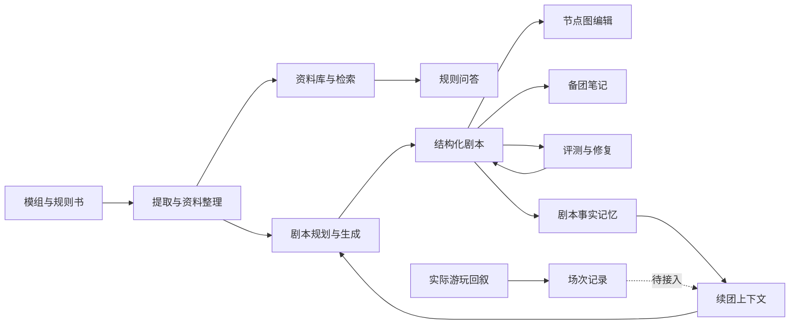

# Tindalos 项目理解与功能核对

这份审查供项目维护者在重构前确认产品目标，回答 Tindalos 服务谁、预期完成什么，以及现有实现和这些目标之间的差距。

审查日期为 2026-11-19，基于 GitHub 仓库 main 分支的提交 `feca892bfbaf7b7a9ca04dc87b2908ad03d7fc9f`。设计材料的独立梳理见同目录的 `review-project-intent.md`；本文件重点核对代码、前端流程和测试。

## 项目服务跑团主持人的备团过程

Tindalos 的产品定位是 AI 辅助 TRPG 备团工作台。主要用户是《克苏鲁的呼唤》的守秘人，即 KP：把规则书和模组材料整理成可主持的剧本，编辑场景、人物与线索，检查剧情结构，并保存信息供下次继续备团。现有网站还提供资料库、规则问答、历史重放、评测和记忆页面。[S1][S2]

项目同时把这个场景作为 Agent 工程的实践对象。README 明确强调离线可测试、输出可评估、失败可降级，以及人能查看和编辑产出。重构需要保留这些工程目标，但产品是否可用仍要由主持人的完整使用过程来判断。[S1]

目前最需要保留的设计是结构化剧本。剧本按幕、场景、事件组织，NPC 和线索通过引用关联；一份剧本可以派生备团笔记、节点图和记忆。重构应保持这些对象的含义及其引用关系明确。[S3]

| 术语 | 本项目中的含义 |
|---|---|
| KP | 人类守秘人；代码中的 KP 主控承担规划和生成编排 |
| 模组 | 上传或输入的原始跑团材料，可以是文本或 PDF |
| Campaign | 生成剧本的聚合对象，包含幕、NPC、线索与世界关系 |
| 剧本节点图 | 剧本的可视化投影，用于浏览、编辑节点和查看剧情连接 |
| 世界知识图谱 | 保存实体语义关系及其时间有效窗，支持查询和一致性检查 |
| 场次回叙 | KP 记录实际游玩摘要、当前进度和规则裁定 |

## 预期功能已经有相应模块

下面区分能力本身和用户流程的完成程度。表中的当前状态来自代码审阅；本轮运行验证的范围见文末。

| 功能 | 预期行为 | 当前实现 |
|---|---|---|
| 模组资料库 | 上传规则书或模组，提取文字和图像，建立可检索资料 | PDF 上传、文件判重、文本提取、图像分类和人工确认已有接口与页面；网页解析使用 pypdfium2。[S4] |
| 剧本生成 | 根据原文规划幕结构，生成 NPC 和场景事件，输出完整剧本 | 网页服务调用 LangGraph 流程，通过 SSE 返回阶段进度；另有模板生成器和可选 LLM 生成器。[S5][S6] |
| 备团笔记 | 汇总前提、场景事件、NPC、世界关系和记忆 | 命令行生成与笔记命令可输出 Markdown；网页生成直接返回剧本对象。[S7] |
| 图形编辑 | 查看幕、场景、事件、NPC 和线索，修改内容、撤销操作、局部重生成 | React Flow 图、抽屉编辑、拖拽和十步撤销已有；手动保存只更新浏览器状态，重生成通过后端接口执行。[S8] |
| 规则问答 | 从资料库检索规则或模组信息，回答时给出来源 | 父子分块、向量与 BM25 混合检索已有；满足条件时由 LLM 回答，失败时返回本地检索摘要。[S9] |
| 剧本质量评估 | 检查结构、引用、线索可达性、内容质量和原文忠实度 | 四维评分与六层评测流程并存，能够保存评测记录和证据；人工 KP 评测层仍跳过。[S10] |
| 剧本修复 | 根据失败项修复，再评估修复结果 | 自动修复限于悬空 NPC、空场景、关系冲突和未连接线索等规则；LLM 建议进入待处理列表。[S11] |
| 跨场次记忆 | 保存人物与世界事实、游玩经过和长期摘要，帮助续团 | 聚合记忆、逐条记忆、整合、场次记录及回看页面已有；回叙摘要进入场次表，尚未接入续写使用的条目检索。[S12] |
| 历史回看 | 打开已有剧本并检查推进顺序 | 当前剧本快照可持久化，重放页面按幕、场景、事件顺序展示；同一剧本 ID 再次注册会覆盖快照。[S13] |
| 规则扩展 | 在统一剧本结构上承接不同 TRPG 规则 | 数据模型接受 COC7 和 DND5e 标签，但生成流程未接入独立规则逻辑；网页生成请求的规则字段未传给生成器。[S3][S4][S5] |

## 剧本结构串联了主要能力

下面是预期的业务流转示意，箭头表达功能关系。现有页面和接口尚未把全部步骤连续接通，具体断点见下一节。

剧本节点图和世界知识图谱需要保留各自的语义。节点图让 KP 看到幕、场景和事件如何推进；世界知识图谱表达人物认识谁、线索指向什么、关系何时有效。后端还提供剧本图投影，而前端自行构建带顺序、分支和引用边的图。两端投影契约需要在重构时核对，不能只按同为“图”合并。[S3][S8][S14]

现有技术组合是 Python 后端、React 前端和本地持久化。Python 侧采用 Pydantic、LangGraph、NetworkX 与 FastAPI；前端采用 React、React Flow 和 Zustand。存储分散于历史库、聚合记忆、记忆条目、评测库、检查点及 Chroma 索引；部署配置把前后端打包进一个容器，并持久化数据目录。[S15]

## 完整使用流程仍有断点

网页生成默认使用模板路径。工作台调用生成流时没有传入开启 LLM 的选项，客户端缺省发送 `llm=false`。后端虽能调用云端模型，但仅配置密钥和服务开关不会使当前工作台按钮自动改用 LLM。[S8][S5]

生成结果和画布没有同步。生成流结束时只更新当前剧本 ID，已有节点不会被新剧本替换。节点抽屉的手动保存也只更新 Zustand，没有写回后端剧本。因此，需要把“选中哪个剧本、正在编辑哪个版本、保存到了哪里”作为重构中的明确状态。[S8]

资料库与生成入口没有直接关联。生成请求只接收文本、LLM 开关、规则标签和可选图像信息，工作台没有选择已上传模组或传递图像结果的流程。现有端到端测试也是分别验证 PDF 检索和另一段文本的生成，不能据此认定上传 PDF 后自动生成剧本已完成。[S4][S8][S16]

多 Agent 的产品含义还需要收紧。网页生成确有并行分支，但默认幕数为 2、NPC 数为 3，数量由环境变量调整。NPC 人格分支主要追加确定性特质和幕内分工；场景生成收到的是 NPC ID 列表，没有把刚生成的人格对象作为独立输入。知识图谱工具调用由程序构造，工具结果回填后被用于进度摘要。这些事实支持“受控的生成流程”，尚不足以认定 NPC 已具备随实际游玩持续变化的独立 Agent 行为。[S6]

场次记录和记忆检索尚未连通。实际游玩摘要写入场次表后触发整合，但整合读取的是已有情景和语义条目；续写检索也读取记忆条目。场次摘要能用于“上次停在哪”的回看，却没有自动变成续写检索所需的新记忆。此外，短期记忆类型有定义和展示，未发现对应写入流程。[S12]

“历史”目前保存同一剧本的最新快照。剧本 ID 由模组文本派生，同样文本对应同样 ID；注册历史时覆盖该 ID 的快照。若重构目标包含反复生成、版本比较和回滚，就需要分别表达原始模组、一次生成、一个剧本版本和实际游玩场次。[S6][S13]

## 评测结果要按实际检查解释

四维确定性评分主要衡量结构和字段：引用是否存在、场景是否有事件、人物是否有描述、分支数量是否足够等。生成流程会把事件的后续引用改写为同场景中所有后续事件，因此分支检查通过不能单独证明玩家拥有有意义的选择。满分也不能直接代表剧本忠实于原文或适合实际主持。[S6][S10]

六层评测已有运行记录，但各层的完成条件不同。人工 KP 层固定跳过；原文忠实度检查当前使用检索命中与词元重叠；没有语料、没有历史对照或关闭 LLM 时，对应层可以跳过。总体通过表示可达检查完成，仍需查看具体层的状态和证据。[S10]

“自进化”在当前代码中应理解为剧本产出的受限修复循环。修复规则有明确范围、轮数上限和停止条件，模型提出的建议不会自动应用。它没有更新模型权重，也没有在循环中自动修改 Agent 程序或生成策略。[S11]

## 重构应先确定业务对象与完成条件

以下为审查者建议。下一版架构首先需要把原始模组、生成任务、剧本版本、世界事实、游玩场次和评测运行分开定义，再明确它们怎样关联。当前部分状态通过同一个剧本 ID 和多处存储维系，页面保存与后端快照又各自更新；这比框架版本更直接影响续团、修订和回看是否可靠。

建议用一个连续场景作为功能验收依据：选择已上传模组生成剧本，画布显示生成结果，修改后重新打开仍能看到修改，记录实际游玩，续写时使用这场游玩的事实，评测能定位到同一模组和具体剧本版本。技术选型应服务这些完成条件。

## 本轮验证范围

本轮审阅了 README、领域模型、生成流程、两套服务入口、前端六个栏目及其数据调用、知识图谱、检索、记忆、评测、修复和部署配置，并查看了相应测试。

本地实际运行了历史存储、配置和包骨架的 35 项测试，全部通过；另对 27 个 Python 源文件做了语法解析。运行这些局部检查的 Python 为 3.9.6，而项目声明要求 Python 3.12 及以上，因此这些结果不等同于声明环境下的全套验证。本轮没有重跑完整后端测试、前端测试和构建，也没有调用真实模型或验证线上部署。

另外，从源码 AST 提取原函数并隔离运行了两个最小反例。这种检查只验证原函数的局部行为，不等同于完整生成或检索流程运行。

| 反例 | 输入 | 实际观察 |
|---|---|---|
| 分支被程序增加 | 三个事件原本只有“进入→触发→结局”的线性连接 | 场景写作函数把第一个事件改为同时指向第二和第三个事件，因此数量型分支检查会通过 |
| 忠实度接受矛盾 | 生成声明为“霍普已经死亡。”；给定检索片段为“霍普还活着。” | 原忠实度判据因为共享“霍普”词元，将声明判为得到支持 |

README 包含多个时期的测试数量、实验结果和技术描述。审查中以本次提交的代码与配置解释当前行为，没有把历史“全绿”或真实 API 实验的陈述当作本轮验证结果。

## 代码出处

所有代码链接固定到本次审查提交，便于后续重构时复核。

| 标记 | 出处 |
|---|---|
| S1 | [README：产品定位与工程目标](https://github.com/SgtBaixiao/tindalos/blob/feca892bfbaf7b7a9ca04dc87b2908ad03d7fc9f/README.md) |
| S2 | [站点栏目与路由](https://github.com/SgtBaixiao/tindalos/blob/feca892bfbaf7b7a9ca04dc87b2908ad03d7fc9f/frontend/src/site/SiteApp.tsx#L65) |
| S3 | [领域模型与规则标签](https://github.com/SgtBaixiao/tindalos/blob/feca892bfbaf7b7a9ca04dc87b2908ad03d7fc9f/src/tindalos/models.py#L110) |
| S4 | [生成请求与 PDF 上传](https://github.com/SgtBaixiao/tindalos/blob/feca892bfbaf7b7a9ca04dc87b2908ad03d7fc9f/src/tindalos/web.py#L63)，[PDF 解析](https://github.com/SgtBaixiao/tindalos/blob/feca892bfbaf7b7a9ca04dc87b2908ad03d7fc9f/src/tindalos/pdfio.py#L1) |
| S5 | [网页生成执行入口](https://github.com/SgtBaixiao/tindalos/blob/feca892bfbaf7b7a9ca04dc87b2908ad03d7fc9f/src/tindalos/serve.py#L69) |
| S6 | [LangGraph 生成节点、人格与场景](https://github.com/SgtBaixiao/tindalos/blob/feca892bfbaf7b7a9ca04dc87b2908ad03d7fc9f/src/tindalos/pipeline.py#L198) |
| S7 | [命令行独立生成流程](https://github.com/SgtBaixiao/tindalos/blob/feca892bfbaf7b7a9ca04dc87b2908ad03d7fc9f/src/tindalos/cli.py#L126)，[备团笔记](https://github.com/SgtBaixiao/tindalos/blob/feca892bfbaf7b7a9ca04dc87b2908ad03d7fc9f/src/tindalos/pipeline.py#L510) |
| S8 | [工作台](https://github.com/SgtBaixiao/tindalos/blob/feca892bfbaf7b7a9ca04dc87b2908ad03d7fc9f/frontend/src/site/WorkbenchView.tsx)，[生成完成状态](https://github.com/SgtBaixiao/tindalos/blob/feca892bfbaf7b7a9ca04dc87b2908ad03d7fc9f/frontend/src/components/ProgressBand.tsx#L60)，[手动保存](https://github.com/SgtBaixiao/tindalos/blob/feca892bfbaf7b7a9ca04dc87b2908ad03d7fc9f/frontend/src/components/NodeDrawer.tsx#L57)，[生成客户端默认值](https://github.com/SgtBaixiao/tindalos/blob/feca892bfbaf7b7a9ca04dc87b2908ad03d7fc9f/frontend/src/lib/live.ts#L141)，[前端图投影](https://github.com/SgtBaixiao/tindalos/blob/feca892bfbaf7b7a9ca04dc87b2908ad03d7fc9f/frontend/src/lib/scriptGraph.ts#L167) |
| S9 | [检索与问答](https://github.com/SgtBaixiao/tindalos/blob/feca892bfbaf7b7a9ca04dc87b2908ad03d7fc9f/src/tindalos/rag.py#L693) |
| S10 | [确定性检查](https://github.com/SgtBaixiao/tindalos/blob/feca892bfbaf7b7a9ca04dc87b2908ad03d7fc9f/src/tindalos/eval_/deterministic.py#L139)，[六层评测](https://github.com/SgtBaixiao/tindalos/blob/feca892bfbaf7b7a9ca04dc87b2908ad03d7fc9f/src/tindalos/eval_/runner.py#L309)，[忠实度判据](https://github.com/SgtBaixiao/tindalos/blob/feca892bfbaf7b7a9ca04dc87b2908ad03d7fc9f/src/tindalos/eval_/runner.py#L197) |
| S11 | [修复规则与演化循环](https://github.com/SgtBaixiao/tindalos/blob/feca892bfbaf7b7a9ca04dc87b2908ad03d7fc9f/src/tindalos/evolve.py#L311) |
| S12 | [记忆条目与续写检索](https://github.com/SgtBaixiao/tindalos/blob/feca892bfbaf7b7a9ca04dc87b2908ad03d7fc9f/src/tindalos/memory_entries.py#L373)，[场次写入](https://github.com/SgtBaixiao/tindalos/blob/feca892bfbaf7b7a9ca04dc87b2908ad03d7fc9f/src/tindalos/memory_entries.py#L887)，[整合读取](https://github.com/SgtBaixiao/tindalos/blob/feca892bfbaf7b7a9ca04dc87b2908ad03d7fc9f/src/tindalos/memory_entries.py#L727) |
| S13 | [历史快照覆盖](https://github.com/SgtBaixiao/tindalos/blob/feca892bfbaf7b7a9ca04dc87b2908ad03d7fc9f/src/tindalos/history.py#L212)，[顺序重放](https://github.com/SgtBaixiao/tindalos/blob/feca892bfbaf7b7a9ca04dc87b2908ad03d7fc9f/frontend/src/site/ReplayPlayer.tsx#L23) |
| S14 | [世界图谱](https://github.com/SgtBaixiao/tindalos/blob/feca892bfbaf7b7a9ca04dc87b2908ad03d7fc9f/src/tindalos/kg.py)，[后端剧本图投影](https://github.com/SgtBaixiao/tindalos/blob/feca892bfbaf7b7a9ca04dc87b2908ad03d7fc9f/src/tindalos/models.py#L191) |
| S15 | [Python 依赖](https://github.com/SgtBaixiao/tindalos/blob/feca892bfbaf7b7a9ca04dc87b2908ad03d7fc9f/pyproject.toml)，[前端依赖](https://github.com/SgtBaixiao/tindalos/blob/feca892bfbaf7b7a9ca04dc87b2908ad03d7fc9f/frontend/package.json)，[容器部署](https://github.com/SgtBaixiao/tindalos/blob/feca892bfbaf7b7a9ca04dc87b2908ad03d7fc9f/deploy/docker-compose.yml) |
| S16 | [端到端测试中的独立输入](https://github.com/SgtBaixiao/tindalos/blob/feca892bfbaf7b7a9ca04dc87b2908ad03d7fc9f/tests/test_e2e_web.py#L36) |

## 表达检查记录

已按 `doc-writing` 确定读者和框架，按 `de-ai-tech-writing` 区分代码事实与审查建议，再按 `haohao-shuohua` 核对事实、清洗表达并检查节奏。首次及补充最小反例后的机械扫描中，半角标点、破折号串、B2 变体、元话语、序号标题和免责尾巴均为 0 命中，无需豁免。
