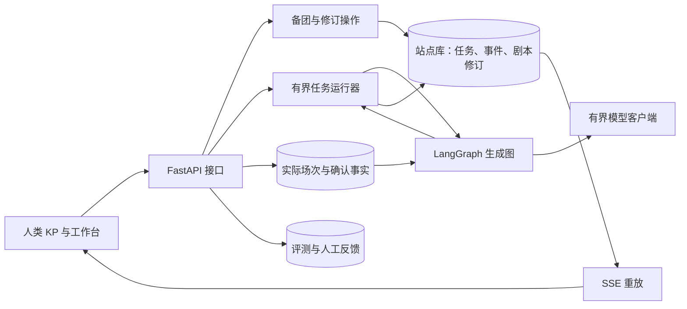

# Tindalos 运行架构

本文供维护者运行和继续修改本轮重构，回答业务如何保存、任务如何结束、续团依据什么，以及哪些扩展需要重新设计。

## 系统先保证保存与状态一致

本轮保留 React、LangGraph、Pydantic 和 NetworkX，修复独立生成入口、无限线程、保存假成功及计划混入实际记忆的问题。备团操作负责资料准备、修订和续团追加；Web 管理 HTTP，任务运行器管理容量和终态，生成图产出建议。

| 用语 | 本文含义 |
|---|---|
| 修订 | 不可变的完整剧本保存版本 |
| WAL | SQLite 预写日志，支持读写并行，仍只有一个写者 |
| CAS | 用期望修订或运行状态作为提交条件 |
| SSE | 带事件序号的服务端事件流 |

## 业务提交由修订库确认

生成完成先校验完整剧本，再在短事务中写新修订、更新当前快照及写结束事件。保存失败时任务失败，客户端不会收到已保存的成功结论。模型执行与网络请求在事务外完成。

编辑提交期望修订，服务端锁定写事务后核对版本。同版本并发编辑只有一个成功，其他请求返回 409；前端整体采用完整响应，保留冲突草稿。来源材料和场次原文保留，坐标与选择属于显示状态。恢复旧修订创建新版本。

旧站点库添加修订号、模组关联及修订表，将旧快照导入为首个历史版本。迁移新增表与字段，保留原有记忆和素材目录。迁移前备份及校验见[验收记录](refactor-validation.md)。

## 任务身份与连接分别管理

提交返回 202 和任务 ID。同一幂等键、同一请求只建立一个任务，同键异内容返回 409。默认 2 个工作线程、容量 16，满载返回 429。事件按任务分配序号，支持游标与 Last-Event-ID，每批读取最多 128 条。

断线只停止订阅。显式取消和完成在写事务中决定唯一终态，已取消任务不能发表结果。默认时限 600 秒，在进度边界及发表前检查；运行中的线程或模型请求无法强制停止，关闭服务仍需等待当前调用结束。单次传输受模型请求超时约束。

重启将未完成任务标为中断。重新提交产生新任务；沿用原幂等键仍返回原任务。图默认使用内存检查点，需要持久检查点的库调用者自行创建和关闭资源。本轮没有实施自动断点续算和远端调用去重。

## 续团优先读取实际记录

场次摘要、实际情景条目和确认事实在同一事务内写入。场次请求带幂等键，完整输入变化返回冲突。事实按战役、主体和知情范围保留确认历史，当前视图取最近记录。派生整合失败时原始场次仍已保存，响应区分两者。

旧生成记忆标为计划来源，实际场次标为实际来源。Web 生成不再提前写计划记忆，局部重生成只在修订提交后更新计划派生内容。续团读取最近 6 场和当前事实，事实优先，上下文预算 24000 字符；超预算会提示截断，完整记录留在档案。

续团基于提交时修订，保留原有幕、NPC 和编辑，新幕、事件及线索使用新修订前缀重编号，内部建议来源同步重映射。已有 NPC 的目标、知识和资源进入场景生成上下文，新增材料仍需 KP 审阅。

## 评测保留未知与人工判断

自动判据使用完整句子和三组窄范围状态反例。检索相似度用于取得材料，不直接证明事实；被否定或引用的句子保持未知。语义改写与复杂推理需要人工或经过校准的模型判断。

忠实度最多检查 40 项，报告总声明和未检查分母。缺少内容裁判、语料或 KP 判断时，总判保持警告；明确状态矛盾判失败。人工反馈关联被评修订，追加保存并保留原 trace。历史四维评分保留兼容，其分支数等指标不能代表实际调查路线。

## 优化围绕已经测量的瓶颈

规划器的工具反馈不再重复调用幕与 NPC 生成。事件边保留生成器结构，避免制造额外分支。数据库缩短事务，场次读取限制窗口；前端位置变更按批次建立 ID 索引，拖动保留内容引用，干净详情草稿才同步新内容。

文字保存保持坐标，初次载入或结构变化才重新布局。节点测量完成后定位画布，窄屏默认折叠图例并隐藏小地图。Worker、视口裁剪和布局性能仍待真实帧时测量，当前基准不能证明数千节点持续交互流畅。

## 配置与部署限制

| 配置 | 默认值与约束 |
|---|---|
| TINDALOS_DATA_DIR | data，素材、站点库、记忆和评测目录的基准 |
| TINDALOS_SITE_DB | 数据目录下 site.db，自定义时保持在该目录内以完整备份 |
| TINDALOS_RAG_DIR | 数据目录下 rag |
| TINDALOS_JOB_WORKERS | 2，运行线程数 |
| TINDALOS_JOB_CAPACITY | 16，排队加运行容量，须不小于工作线程数 |
| TINDALOS_JOB_TIMEOUT | 600 秒，协作式执行预算 |
| TINDALOS_GRAPH_CONCURRENCY | 4，每个 Web 生成图的并发上限 |
| TINDALOS_MODEL_CONCURRENCY | 4，全进程模型传输并发上限 |

SQLite 文件要求本机可靠磁盘，WAL 不适用于网络共享目录。启动锁提供 Mac/Linux 和 Windows 分支，Windows 尚未实机验收。本机 Python 3.12.16 链接 SQLite 3.53.1，部署需核对底层版本，尤其 [WAL 修复版本](https://www.sqlite.org/wal.html)。

后端使用 uv.lock，CI 与容器同步锁文件；Node.js 24 和 npm 锁文件构建前端。本机没有 Docker 可执行程序，容器尚未构建。公开部署没有账号认证，知情范围是本机筛选标签。

多主机、高可用或持续写竞争成为要求后，再评估 PostgreSQL、租约认领、事务发件箱和全局模型限额。资料库沿用 Chroma/BM25，FTS5 替换需要固定中文查询集验证召回。

## 源码与研究入口

| 职责 | 位置 |
|---|---|
| HTTP 与生命周期 | src/tindalos/web.py |
| 任务、事件、独占与预算 | src/tindalos/jobs.py、src/tindalos/lease.py |
| 修订事务和历史迁移 | src/tindalos/history.py |
| 模组准备、编辑、续团重编号 | src/tindalos/workspace.py |
| 生成与模型传输 | src/tindalos/pipeline.py、src/tindalos/generator.py、src/tindalos/llm.py |
| 场次与评测保存 | src/tindalos/memory_entries.py、src/tindalos/eval_store.py |
| 工作台、订阅与草稿 | frontend/src/site/WorkbenchView.tsx、frontend/src/components/JobProgress.tsx、frontend/src/components/NodeDrawer.tsx |

依据见[运行研究](research-runtime-storage.md)、[客户端研究](research-client-evaluation.md)和 [ADR](adr/0001-local-runtime.md)。条件调查图、带页码的自动事实抽取和重启自动续算尚未实现；大规模压测尚未执行。实际范围以本说明和[验收记录](refactor-validation.md)为准。
